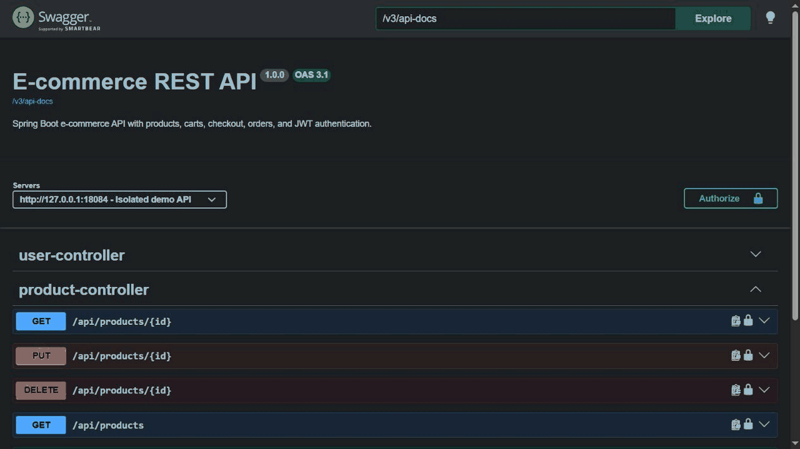
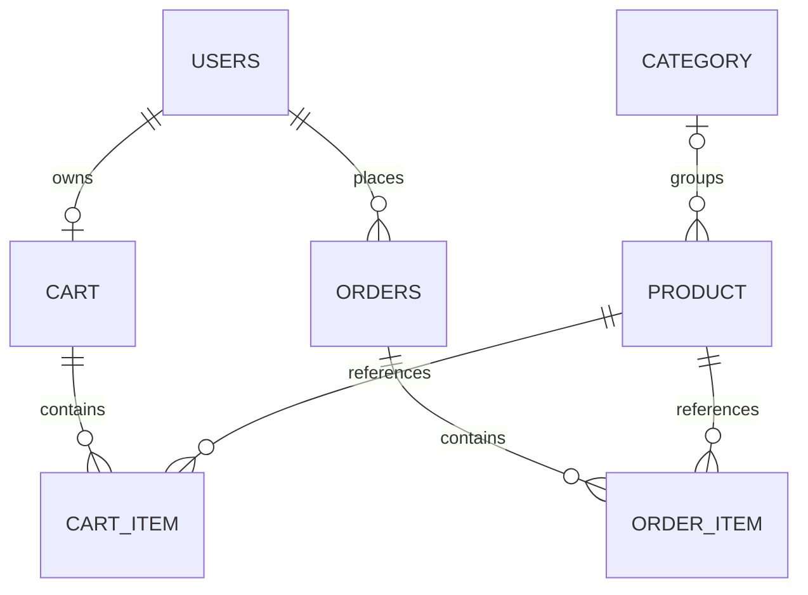

# E-Commerce REST API

A Java 21 and Spring Boot backend for a small online store. It manages a product catalog, JWT authentication, customer carts, and orders with transactional stock deduction and purchase price snapshots.

The project focuses on readable backend business logic, PostgreSQL persistence, ownership checks, and tests that exercise real database concurrency.

### API Demo



The demo shows JWT authorization, product browsing, cart management, and transactional checkout.

## Features

- Product and category CRUD, with product pagination and sorting.
- Registration and login, BCrypt password hashing, and stateless JWT authentication.
- Authenticated carts: add products, change quantities, remove items, and clear the cart.
- Checkout with PostgreSQL row locks, stock validation, and atomic stock deduction.
- Order totals calculated with `BigDecimal`; order items retain the purchase price.
- Order history and ownership checks for individual orders and cart items.
- Request/response DTOs, Bean Validation, and structured JSON errors.
- Versioned Flyway schema migrations and Hibernate schema validation.
- Docker Compose with an API service and persistent PostgreSQL storage.
- Mockito unit tests, MVC tests, and PostgreSQL integration tests.
- OpenAPI documentation and Swagger UI.

## Technology

| Component | Version / purpose |
| --- | --- |
| Java | 21 |
| Spring Boot | 4.1.1 |
| Spring Web MVC | REST controllers |
| Spring Data JPA / Hibernate | Persistence and transaction management; Boot-managed versions |
| Spring Security | Stateless JWT filter chain and BCrypt |
| PostgreSQL | Compose/test image: 18; local verification: 18.4 |
| Flyway | 12.4.0, managed by Spring Boot, with PostgreSQL module |
| JJWT | 0.12.6 |
| Springdoc OpenAPI | 3.1.1 |
| Maven | Wrapper: 3.9.16 |
| JUnit Jupiter / Mockito | Versions managed by Spring Boot; Boot 4.1.1 resolves Jupiter 6.0.3 |
| Testcontainers | 2.0.5, managed by Spring Boot |

The existing tests use the Jupiter API (`org.junit.jupiter`); the project retains the testing versions selected by Spring Boot.

## Architecture

```text
HTTP + JWT filter -> Controller -> Service -> Repository -> PostgreSQL
                         DTOs     Transactions    JPA
```

Code lives under `com.youssef.ecommerce`, grouped by feature: `auth`, `user`, `category`, `product`, `cart`, and `order`. Security configuration and exception handling are shared. The application starts from `EcommerceApplication`.

Controllers translate requests and responses into DTOs. Services enforce business rules. Spring Data repositories manage entity persistence. Flyway owns schema creation; Hibernate runs with `ddl-auto=validate`.

## Database relationships



Tables are `users`, `category`, `product`, `cart`, `cart_item`, `orders`, and `order_item`. The diagram describes normal application relationships; the migration preserves the existing entities' nullable foreign keys. `cart.user_id` is unique. Foreign keys and indexes support the relationships, email lookup, and price sorting.

The initial migration preserves existing JPA defaults, including `numeric(38,2)` monetary columns and `timestamp(6)` order timestamps. Email uniqueness is currently checked in the registration service, not enforced by a database unique constraint. This existing limitation is not silently changed by the initial migration.

## Transactional checkout and concurrency

`POST /api/orders/checkout` runs in one transaction:

1. Resolve the authenticated user and lock their cart, serializing repeated checkout requests for that cart.
2. Reject an empty cart.
3. Lock each distinct product in ascending product ID order using `PESSIMISTIC_WRITE`.
4. Refresh each product while acquiring its lock. This matters because the cart may have already loaded a managed product with stale stock.
5. Validate positive requested quantities and aggregate duplicate product lines before checking stock.
6. Create the order and copy each product's current `BigDecimal` price into its order item.
7. Calculate line totals and the order total, deduct stock, and persist the order.
8. Clear the cart inside the same transaction.

PostgreSQL holds the locks until commit or rollback. A competing buyer waits and then reads the committed remaining stock. If there is only one unit, only one of the two buyers can complete checkout. Insufficient stock still returns **409 Conflict**; failure leaves stock, orders, and cart contents unchanged. Product updates also acquire a product lock before changing its fields.

Locks are taken in consistent product ID order to reduce deadlock risk. The integration test checks actual PostgreSQL lock waits before allowing two buyers to compete for the final unit.

## Authentication and authorization

Register or log in to receive a JWT, then send:

```http
Authorization: Bearer <token>
```

Passwords are stored as BCrypt hashes. Authentication is stateless. Cart and order controllers use the token's email rather than a client-supplied user ID. Updating or removing another user's cart item returns the existing **400** response; reading another user's order returns **403**. Missing or invalid authentication on protected endpoints returns **401**.

Public access is allowed for `/api/auth/**`, product/category GET requests, and Swagger/OpenAPI endpoints. Other requests require authentication. Existing security rules are preserved: catalog writes and the legacy user CRUD endpoints are available to authenticated users; no administrator role or additional user-resource ownership policy is introduced.

## Main endpoints

| Method | Path | Purpose |
| --- | --- | --- |
| POST | `/api/auth/register` | Register and receive a JWT |
| POST | `/api/auth/login` | Authenticate and receive a JWT |
| GET | `/api/products` | Public paginated product listing |
| GET | `/api/products/{id}` | Public product details |
| POST / PUT / DELETE | `/api/products[/{id}]` | Create / update / delete products |
| GET | `/api/categories[/{id}]` | Public category listing / details |
| POST / PUT / DELETE | `/api/categories[/{id}]` | Create / update / delete categories |
| GET / POST | `/api/users` | Existing user listing / creation |
| GET / PUT / DELETE | `/api/users/{id}` | Existing user details / update / delete |
| GET | `/api/cart` | Authenticated user's cart |
| POST | `/api/cart/items` | Add a product |
| PUT | `/api/cart/items/{cartItemId}` | Change an owned item's quantity |
| DELETE | `/api/cart/items/{cartItemId}` | Remove an owned item |
| DELETE | `/api/cart/items` | Clear the cart |
| POST | `/api/orders/checkout` | Purchase the authenticated user's cart |
| GET | `/api/orders/my-orders` | Authenticated user's order history |
| GET | `/api/orders/{orderId}` | Retrieve an owned order |

Bracketed ID suffixes in the table describe route variants, not literal URL characters. Create operations use collection routes; update/delete operations use ID routes.

## Example checkout workflow

Use Swagger UI or an HTTP client. Replace the placeholders with values from your own database and responses.

```http
POST /api/auth/register
Content-Type: application/json

{"firstName":"Example","lastName":"Buyer","email":"buyer@example.com","password":"<your-password>"}
```

Copy the returned `token`, then browse `GET /api/products`. With an existing product ID:

```http
POST /api/cart/items
Authorization: Bearer <token>
Content-Type: application/json

{"productId":1,"quantity":2}
```

```http
GET /api/cart
Authorization: Bearer <token>

POST /api/orders/checkout
Authorization: Bearer <token>

GET /api/orders/my-orders
Authorization: Bearer <token>
```

Checkout returns an order with item quantities, purchase prices, total amount, and creation time. It clears the cart after a successful transaction. There is no seeded catalog or demo account.

## Product pagination

```http
GET /api/products?page=0&size=10&sort=price,asc
```

- Zero-based `page`; default `0`.
- `size` defaults to `10`; allowed range `1..100`. Larger values are rejected, not silently clamped.
- `sort` accepts one `field,direction` pair. Fields: `id`, `name`, `price`, `quantity`; direction: `asc` or `desc`.
- Default sorting: `id,asc`. Other fields include an ascending ID tiebreaker for consistent ordering.
- Invalid pagination numbers, fields, or directions return **400**.

**API change:** the product listing previously returned a bare array. It now uses Spring Data's `PagedModel` with DTO content and page metadata:

```json
{
  "content": [
    {"id": 1, "name": "Mouse", "description": "USB mouse", "price": 25.50,
     "quantity": 8, "categoryId": null, "categoryName": null}
  ],
  "page": {"size": 10, "number": 0, "totalElements": 1, "totalPages": 1}
}
```

Clients should read `content` rather than treating the response root as an array. No product search/filter endpoint existed before this change.

## Environment configuration

| Variable | Local default / requirement |
| --- | --- |
| `DB_URL` | `jdbc:postgresql://localhost:5432/ecommerce_db` |
| `DB_USERNAME` | `postgres` locally; Compose defaults to `ecommerce` |
| `DB_PASSWORD` | Required; use your own PostgreSQL password |
| `JWT_SECRET` | Required; a randomly generated signing secret of at least 32 UTF-8 bytes |
| `API_PORT` | Compose host port, default `8080` |

IntelliJ's existing `DB_PASSWORD` and `JWT_SECRET` configuration continues to work. Local Spring Boot execution reads environment variables; it does not automatically read `.env`. Compose reads `.env`. `.env` files are ignored by Git; `.env.example` contains placeholders only.

## Flyway setup

The initial migration is `src/main/resources/db/migration/V1__initial_schema.sql`. On an **empty database**, application startup creates the schema with Flyway, then Hibernate validates it. Later schema changes should be new versioned migrations; do not edit an already-applied migration.

Both `spring.flyway.schemas` and `spring.flyway.default-schema` are explicitly `public`. Add future changes as `V2__description.sql`, `V3__description.sql`, and so on; Flyway applies them in `public`. Do not rerun baseline on a database that already has a successful baseline.

`baseline-on-migrate=false` and `clean-disabled=true` are explicit. Starting against a non-empty database without Flyway history fails safely instead of automatically assuming that its schema is correct.

### Adopting an existing database without Flyway history

This procedure is only for a populated database that has not yet been adopted by Flyway. If `public.flyway_schema_history` already contains a successful baseline, skip this procedure and start the application normally. Do **not** run V1 directly against existing tables or enable automatic baselining. For an unadopted database, first verify its schema:

1. Stop the application and make a backup. Run PostgreSQL tools from a PowerShell terminal where they are on `PATH` (or use the `bin` directory of your PostgreSQL installation). Password prompts keep secrets out of command arguments:

   ```powershell
   pg_dump -h localhost -p 5432 -U postgres -d ecommerce_db -Fc -f ecommerce_db_before_flyway.dump
   pg_dump -h localhost -p 5432 -U postgres -d ecommerce_db --schema-only --no-owner --no-privileges -f existing-schema.sql
   ```

2. Create a **separate reference database**, provided that name does not already exist. Apply V1 to that empty database only:

   ```powershell
   createdb -h localhost -p 5432 -U postgres ecommerce_baseline_reference
   psql -h localhost -p 5432 -U postgres -d ecommerce_baseline_reference -v ON_ERROR_STOP=1 -f .\src\main\resources\db\migration\V1__initial_schema.sql
   pg_dump -h localhost -p 5432 -U postgres -d ecommerce_baseline_reference --schema-only --no-owner --no-privileges -f reference-schema.sql
   ```

3. Compare the dumps in IntelliJ or inspect both schemas in pgAdmin. Check all seven tables, column types/lengths/nullability, identity generation and sequences, primary keys, foreign keys, the unique `cart.user_id`, and indexes. Constraint names, dump metadata, and sequence ownership names may differ; compare their definitions. The new non-unique indexes may be absent from the old database. Any missing index must be reviewed and added explicitly before declaring the baseline equivalent; baselining does not execute V1. If other differences exist, stop and prepare a reviewed, data-preserving reconciliation procedure. Hibernate validation alone does not verify all indexes and constraints.

4. **Only after confirming the schema matches**, use a separately installed Flyway CLI to record version 1. In a terminal with `DB_PASSWORD` already set, supply it through Flyway's environment variable:

   ```powershell
   $env:FLYWAY_PASSWORD = $env:DB_PASSWORD
   flyway '-url=jdbc:postgresql://localhost:5432/ecommerce_db' '-user=postgres' '-schemas=public' '-defaultSchema=public' '-createSchemas=false' '-baselineVersion=1' '-baselineDescription=Existing JPA schema' baseline
   Remove-Item Env:FLYWAY_PASSWORD
   ```

   This explicitly creates Flyway history and records version 1; it does not create application tables or apply V1. Do not run it if a Flyway history table already exists without first inspecting that history. Never baseline an empty database at version 1: it would skip schema creation.

5. Restart the application with `ddl-auto=validate`. Future migrations run normally. Keep backups and schema dumps outside the repository.

No baseline or reconciliation SQL is run automatically. A fresh Compose database does not require these existing-database steps.

## Run locally / IntelliJ IDEA

Prerequisites: JDK 21, PostgreSQL, and Maven or the included Maven Wrapper.

For a new installation, create an empty `ecommerce_db` in pgAdmin. For an existing database without Flyway history, follow the adoption procedure above. An already-baselined database needs no further baseline step.

In IntelliJ, use JDK 21, open the existing Maven project, keep `DB_PASSWORD` and `JWT_SECRET` in the run configuration, and run `com.youssef.ecommerce.EcommerceApplication`.

From PowerShell, with those environment variables set in the current terminal:

```powershell
Set-Location 'D:\All projects Dev\Ecom REST API\Ecom REST API'
.\mvnw.cmd spring-boot:run
```

IntelliJ run-configuration variables are not automatically inherited by a separate PowerShell terminal.

## Run with Docker Compose

Start Docker Desktop with its Linux engine. In the project directory:

```powershell
Copy-Item .env.example .env
```

Edit `.env` and replace the database password and JWT secret placeholders. Then:

```powershell
docker compose config --quiet
docker compose up --build
```

The API is available at `http://localhost:8080`. Change `API_PORT` if another local API already uses that port. PostgreSQL is reachable only on the Compose network, so it does not conflict with host PostgreSQL on port 5432. Compose uses a separate named volume and does not connect to the local `ecommerce_db`.

The database health check gates API startup. Flyway initializes the fresh schema. PostgreSQL 18 stores data under the mounted `/var/lib/postgresql` directory. The API runs as a non-root user.

Stop the services while retaining database data:

```powershell
docker compose down
```

Changing credentials in `.env` does not rewrite credentials in an already-initialized PostgreSQL volume.

## Automated tests

```powershell
.\mvnw.cmd clean test
.\mvnw.cmd package
```

Equivalent commands with installed Maven: `mvn clean test` and `mvn package`. The wrapper avoids requiring a global Maven installation.

- Unit tests retain existing authentication, cart, and order behavior and check lock ordering and duplicate-line stock validation.
- MVC tests check pagination defaults, DTO/page responses, sorting, and invalid input.
- `PostgresIntegrationTest` uses a disposable PostgreSQL 18 Testcontainer when Docker is available. It runs with Flyway and `ddl-auto=validate`, and covers concurrent checkout, stock/total/cart changes, rollback, JWT authentication, cart and order ownership, order history, and database pagination.
- Without Docker, the PostgreSQL test class is explicitly skipped. Unit/MVC tests still run and never use the local application database.

To run only PostgreSQL integration tests with Docker:

```powershell
.\mvnw.cmd '-Dtest=PostgresIntegrationTest' test
```

For environments without Docker, there is an explicit alternative for a **disposable** PostgreSQL cluster on `127.0.0.1:55439`, with database `ecommerce_integration` and role `integration`. That test database must already exist and accept the test connection. Tests clear all its application data. The URL is restricted to this exact endpoint:

```powershell
.\mvnw.cmd clean test '-Disolated.postgres.url=jdbc:postgresql://127.0.0.1:55439/ecommerce_integration'
```

The fallback was used for verification against an isolated PostgreSQL 18.4 cluster. The default tests never connect to `localhost:5432/ecommerce_db`. Test reports are generated under `target/surefire-reports`.

## API documentation

- [Swagger UI](http://localhost:8080/swagger-ui.html)
- [OpenAPI JSON](http://localhost:8080/v3/api-docs)

Use **Authorize** with a token from registration/login to explore protected endpoints.
